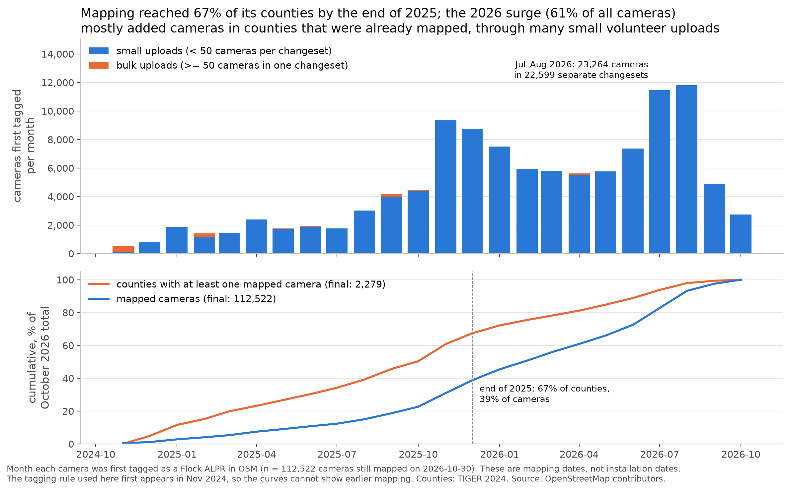
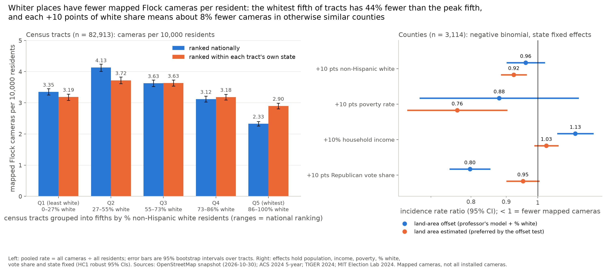
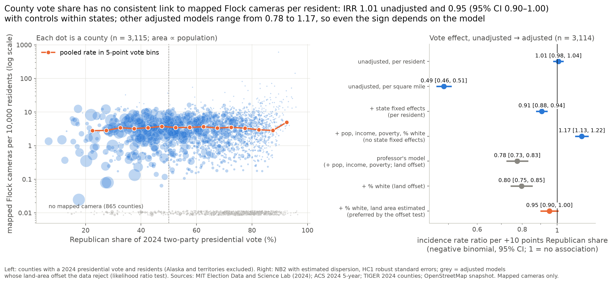

# cs418-flockers
A UIC CS 418 data science research project on ***Flock Safety***.


## Research Questions

Item: Where are mapped Flock cameras, and how has the mapping grown over time?
Item: Is mapped camera density associated with community characteristics?
Item: Is mapped camera density associated with political voting patterns?

Item: Research on Flock's business model
Item: does the race pattern survive an urban/rural control? How is the mapped density split across the urban/rural divide?
Item: do cameras follow roads more than residents?
Item: 
Visual: 
Map of chicago highlighting roads, and mapped nodes of flock cameras nodes with visual representation direction they are facing. 
Item: 
Visual:
Flock cameras per state
ALPR cameras per state
Item: 
Visual:
Crime rate per state
Item:
Visual:
How many agencies use flock 


MODELS:
regression model to answer your research questions: can you predict camera density (dependent variable) based on urban/rural, vote pattern, population, income, other community characteristics? Formally, at the county level, try to model:
flock_count ~ log_area + log_pop + log_income + poverty_rate + urban_share + gop_share_2024 + C(state) + ... ?
offset = log(land_sq_mi)
family = negative binomial (NB2)
The offset will make sure you predict cameras per square mile, and the C(state) will account for any constants within a state, for example, any state-specific rules. Once you have this model set up (LLMs are helpful for this :-) ), it will tell you which factors meaningfully help predict cameras per square mile, i.e. which predictors are statistically significant.


## Main Findings (Narrative Analysis)

- Mapping of Flock cameras in OpenStreetMap spread geographically before it grew in volume: by the end of 2025 it had reached 67% of the 2,279 counties now mapped but only 39% of the 112,522 dated cameras, and 94% of the cameras added in 2026 (61% of the total) went into counties that were already mapped, through many small volunteer uploads rather than bulk imports.
- Whiter places have fewer mapped Flock cameras per resident: the whitest fifth of census tracts has 2.33 per 10,000 residents (95% CI 2.25–2.40), 44% fewer than the peak fifth's 4.13 (4.01–4.24), and in a county negative binomial regression each +10 points of non-Hispanic white share is associated with 8% fewer cameras (IRR 0.92, 95% CI 0.89–0.96) when population, income, poverty, vote share and state are held fixed.
- County 2024 Republican vote share has no consistent association with mapped cameras per resident: the unadjusted incidence rate ratio is 1.01 per +10 points (95% CI 0.98–1.04) and the adjusted within-state estimate is 0.95 (0.90–1.00), while other specifications range from 0.78 to 1.17, so even the sign depends on the model.

All numbers and figures are produced by [`checkpoints/Narrative_Analysis/narrative.ipynb`](checkpoints/Narrative_Analysis/narrative.ipynb). Longer notes on methods, model diagnostics, every check and the analyses we left out are in [`NARRATIVE.md`](checkpoints/Narrative_Analysis/NARRATIVE.md). Throughout, "cameras" means Flock cameras *mapped* in OpenStreetMap, not all installed cameras, and every result is an association, not a cause.

### Finding One: OpenStreetMap's Flock map spread to new counties first, then filled in through mass volunteer mapping

Before asking who lives near mapped cameras, we need to know what the map measures. The OSM history file records the month each of the 112,522 currently mapped Flock cameras was first tagged, and we placed every camera in a county. Two cumulative measures then tell different stories. Counting cameras, 61% of today's map was added in January–October 2026, peaking at 11,457 and 11,807 cameras in July and August 2026. Counting places, mapping had already reached 67% of the 2,279 counties that now have a camera by December 2025, when only 39% of the cameras were mapped. And 94% of the cameras first tagged in 2026 fell in counties that already had one. So the 2026 surge mostly made the map denser where mapping already existed rather than extending it to new places. One alternative explanation is a data quirk: a few editors bulk-importing a dataset or re-tagging existing objects. The two peak months came through 22,599 separate changesets (uploads) from at least 9,243 accounts. None came in a changeset of 50 or more cameras, and only 1.4% re-tagged an existing object. A second check uses a different date, the day each OSM object was created rather than tagged. It gives almost the same 2026 share (60% vs 61%), so the surge is not a tag-renaming artifact. The curve's *start* is an artifact, though: all 657 nodes created before November 2024 met the current tagging rule only later. These counts cover the whole cohort, so the uncertainty is about meaning, not sampling. OSM records mapping dates, so we cannot tell whether the bursts also match installations; the repo has no installation or contract dates. The geography is more reliable than the timing. State totals track population (Spearman ρ = 0.89, 95% bootstrap CI 0.80–0.94) and agree in rank with Finding Flock's independent counts (ρ = 0.976, CI 0.94–0.99). ZIP-code spread could not be measured because the repo has no ZIP boundary file.



### Finding Two: Whiter places have fewer mapped Flock cameras per resident, at both tract and county level

With a map whose geography we can broadly trust, we compared 82,913 census tracts (ACS 2024 5-year, zero-camera tracts included) grouped into fifths by non-Hispanic white share. The whitest fifth (86–100% white) has 2.33 mapped cameras per 10,000 residents (95% bootstrap CI 2.25–2.40), 44% fewer than the 27–55% white fifth's 4.13 (4.01–4.24). Following our professor's suggestion, we then fitted a county negative binomial (NB2) regression. It covers 3,114 counties, including the 864 with zero cameras, and uses state fixed effects, with the dispersion estimated rather than assumed. NB2 fits far better than Poisson. The counts are heavily overdispersed (Poisson Pearson χ²/df = 39), and NB2 lowers the AIC from 75,801 to 20,635. The suggested `urban_share` variable is not in the repo, so it is left out. We also tested the suggested land-area offset, which assumes cameras grow in proportion to square miles. When the data estimate that exponent instead, it comes out near 0 (0.02, CI −0.07 to 0.10), not 1, and the fit improves sharply (likelihood ratio 733, AIC 19,904). In other words, mapped cameras follow people, not land. In that preferred model, each +10 points of white share goes with 8% fewer cameras (IRR 0.92, 95% CI 0.89–0.96). The estimate is the same with a population offset or state-clustered errors (CI 0.88–0.97), and stronger without state fixed effects (0.79). Under the land-area offset it is weaker (0.96, CI 0.90–1.02). Ranking tracts within their own state shrinks the tract gap to 2.90 vs 3.72, so about half of it is regional. The whitest fifth also stays lowest within every population-density tercile. Income and poverty are not robust. Tract quintiles are nearly flat (3.14–3.79 and 3.20–3.63 per 10,000). In counties, income matters only under the land-area offset (+13% per +10% income). Higher poverty predicts fewer cameras in the preferred model (IRR 0.76 per +10 points) but not under the offset (0.91, CI 0.71–1.16). Income and poverty overlap (VIF 4.2 and 3.7), and the model still under-predicts zero-camera counties (595 expected vs 864 observed). This describes where *mapped* cameras sit relative to who lives there. It is not evidence of targeting, and mapping completeness may itself differ by place.



### Finding Three: County vote share has no consistent association with mapped cameras once other factors are considered

If composition matters, does politics explain anything beyond it? We compared the vote coefficient before and after adjustment in the same negative binomial models. Per resident and unadjusted, a 10-point more Republican county has essentially the same number of mapped cameras (IRR 1.01, 95% CI 0.98–1.04; raw Spearman ρ = −0.095). Per square mile, the unadjusted gap looks huge (IRR 0.49), but that is county size: Republican counties are large and sparsely populated, and vote share correlates −0.53 with population. Within states, Republican counties have 9% fewer cameras per resident (IRR 0.91, CI 0.88–0.94). Adding population, income, poverty and % white shrinks this to 0.95 (0.90–1.00, p = 0.07), and clustering errors by state widens it to 0.88–1.03. The professor's land-area-offset model gives 0.78 (0.73–0.83), but the offset test in Finding 2 rejects that specification. Dropping state fixed effects reverses the sign to 1.17 (1.13–1.22), which points to differences between states rather than within them (Republican-leaning Georgia and Texas are among the most heavily mapped states). dev3's linear model agrees: the vote coefficient goes from −0.070 with state effects alone to +0.007 (CI −0.029 to +0.042) with controls. Within county-size bands the raw pattern also has no consistent direction (under 25,000 people, 3.64 → 2.77 per 10,000; 100,000–500,000 people, 3.37 → 3.90). We read this as a supported null. Any political association is small, and its direction depends on whether counties are compared within or across states. Two limits remain. Income and composition correlate with vote, so the adjusted models answer a narrower question. And county vote is only a rough proxy for the politics of the agencies and businesses that buy cameras.




## Datasets
Primary datasets describe Flock cameras. Secondary datasets provide community, geographic and political context. Full datasets are **gitignored**: the repo tracks only small samples in `data/processed/samples/` (made by `scripts/create_dataset_samples.py`). To reproduce the analysis, place the full files at the paths below.

| Dataset | Provider and access | Snapshot / reference period | Coverage | Format | Local path | Fetch script |
|---|---|---|---|---|---|---|
| **OSM camera locations** (primary) | OpenStreetMap contributors via the Overpass API | Filename date 2026-10-30 (see limitation below) | U.S. (`ISO3166-1=US`); nodes tagged `man_made=surveillance` + `surveillance:type=ALPR` + `manufacturer~Flock`; 112,830 rows | CSV, all OSM tags in `all_tags` (JSON) | `data/raw/flock_osm/osm_flock_us_locations_2026-10-30.csv` | `fetch_osm_alpr_cameras.py --nationwide --flock-only --format csv` |
| **OSM mapping history** (primary) | Overpass API snapshot + OSM API 0.6 node history | Pulled 2026-10-30; dates span OSM edits up to 2026-10-30 | Same tag rule; 112,527 rows, all `history_ok=true` | CSV | `data/raw/flock_osm/flock_us_historical_2026-10-30.csv` | `fetch_osm_flock_history.py` |
| **Finding Flock** (primary, validation) | [findingflock.com](https://www.findingflock.com/stats) downloads | Download date not recorded | 2,422 cities, 52 state rows | CSV, city GeoJSON | `data/raw/finding_flock/` | None (manual download) |
| **ACS 5-year tables** | U.S. Census Bureau; tables B01003 (population), B19013 (median household income), S1701 (poverty), B03002 (race/ethnicity) | 2013–2017 and 2020–2024 5-year estimates | All tracts in 50 states, DC and Puerto Rico (74,001 tracts in 2017; 85,382 in 2024) | CSV (data, column metadata and table notes per table) | `data/raw/census/<topic>/<year>/` | None (manual download; Data / Column-Metadata / Table-Notes layout) |
| **TIGER/Line tracts** | U.S. Census Bureau [TIGER/Line](https://www2.census.gov/geo/tiger/) | 2017 and 2024 vintages | 50 states + DC, one ZIP per state (51 per year) | Zipped shapefile | `data/external/census_boundaries/{2017,2024}/` | `fetch_census_track_boundaries.py` |
| **TIGER/Line counties** | U.S. Census Bureau TIGER/Line | 2024 vintage | National | Zipped shapefile | `data/external/census_boundaries/counties/tl_2024_us_county.zip` | None (manual download) |
| **County presidential returns** | [MIT Election Data and Science Lab](https://doi.org/10.7910/DVN/VOQCHQ) | 2000–2024 elections; file `version` 20260225 | All counties; 94,151 rows | CSV + codebook (`County Presidential Returns 2000-2024.md`) | `data/raw/elections/presidential/` | None (manual download) |
| **Atlas of Surveillance** (exploratory only) | EFF, [atlasofsurveillance.org](https://atlasofsurveillance.org/data-library), CC BY 4.0 | Downloaded 2026-09-28 | U.S. agencies; 15,135 agency–technology rows | CSV | `data/raw/atlas_of_surveillance/atlas_of_surveillance_2026-09-28.csv` | `fetch_atlas_of_surveillance.py` |
| **Census urban/rural** (not yet analyzed) | U.S. Census Bureau, 2020 Census urban areas | 2020 Census | All counties (3,234 rows) plus Connecticut's 9 planning regions in a separate `CT_2022` sheet | Excel (`2020_UA_COUNTY`, `CT_2022` and notes sheets); reading it needs `fastexcel` | `data/raw/census/urban_rural/2020/2020_UA_COUNTY.xlsx` | None (manual download) |
| **TIGER/Line roads** (not yet analyzed) | U.S. Census Bureau TIGER/Line | 2024 vintage | Primary and secondary roads for 50 states + DC (one ZIP per state, 51 files) plus one national primary-roads file (17,522 road lines) | Zipped shapefile | `data/external/census_boundaries/roads/2024/` | `fetch_census_roads.py --download` |
| **HPMS road sections** (not yet analyzed) | FHWA Highway Performance Monitoring System via data.transportation.gov (dataset `42um-tgh5`), U.S. government work | 2024 HPMS; downloaded 2026-11-13 | **Illinois only** (`stateid=17`); 445,757 road sections, 8 of the 95 columns (`stateid`, `county_id`, `urban_id`, `f_system`, `aadt`, `sectionlength`, `route_id`, `line`) | CSV (geometry as WKT text in `line`) and GeoJSON, same rows | `data/external/hpms/2024/hpms_illinois_2024.{csv,geojson}` | `fetch_hpms.py --download` with a filtered `--url` and `--name` (default URL is the full national export) |
| **LEHD LODES workplace jobs** (not yet analyzed) | U.S. Census Bureau LEHD, LODES8 Workplace Area Characteristics (WAC), all workers (`S000`), all jobs (`JT00`) | 2023 for 49 states; Alaska 2016 and Michigan 2021 (newest year available) | Census blocks in 50 states + DC (51 files) | Gzipped CSV | `data/raw/lehd_lodes/wac/<st>_wac_S000_JT00_<year>.csv.gz` | `fetch_lehd_lodes.py --download` |

### What each dataset provides
- **OSM camera locations:** A snapshot of the Flock license plate reader cameras that volunteers have mapped in OpenStreetMap. Each row is one mapped camera with its location and all of its OSM tags.
- **OSM mapping history:** The OSM edit history of the same mapped Flock cameras. It gives mapping dates for each camera, such as when it was first added and first tagged as Flock, not when it was installed.
- **Finding Flock:** Camera counts by city and by state from findingflock.com, an independent tracker whose counts include other vendors as well as Flock. It serves as a check on the OSM map.
- **ACS 5-year tables:** Census Bureau survey estimates for every census tract on population, median household income, poverty and race/ethnicity. Each table comes with column metadata and table notes.
- **TIGER/Line tracts:** Census Bureau shapefiles of census tract boundaries, one file per state. They give each tract's shape and ID, which link locations to the ACS tract estimates.
- **TIGER/Line counties:** A national Census Bureau shapefile of county boundaries, with each county's shape and ID.
- **County presidential returns:** Vote counts by county and candidate for every presidential election from 2000 to 2024, compiled by the MIT Election Data and Science Lab.
- **Atlas of Surveillance:** EFF's database of which U.S. law enforcement agencies use which surveillance technologies, with one row per agency and technology. It is used for exploration only.
- **Census urban/rural:** A Census Bureau table that splits each county's population, housing and land area into urban and rural parts, based on the 2020 Census urban areas.
- **TIGER/Line roads:** Census Bureau shapefiles of the primary and secondary roads in each state, plus a national file of primary roads. They show where the major roads are, with each road's name and type.
- **HPMS road sections:** Federal Highway Administration records of Illinois road sections, each with its road class, length and, where measured, its average annual daily traffic (AADT).
- **LEHD LODES workplace jobs:** Census Bureau counts of jobs by the census block where people work, one file per state. They show where people work during the day, not where they live.

Running a fetch script names its output after the UTC (OSM) or local (Atlas) run date, so a new download never overwrites the research snapshot. The OSM scripts query live data, so a rerun returns a newer, different map. The research uses the frozen files above.


### Limitations
- **Mapped is not installed.** OSM covers only cameras that volunteers have mapped and tagged with the rule above. Cameras tagged only by `brand` or `operator` are excluded. OSM dates (`first_insert_date`, `first_tagged_date`, `last_edit`) are mapping dates, not installation dates.
- **The two OSM files are separate pulls.** The locations and history files come from different Overpass queries, so their row counts differ (112,830 vs 112,527 raw rows). The analysis reports 112,823 cameras in the snapshot and 112,522 with a history date (see [`NARRATIVE.md`](checkpoints/Narrative_Analysis/NARRATIVE.md)).
- **The locations filename date is unverified.** `osm_flock_us_locations_2026-10-30.csv` contains OSM edits timestamped as late as 2026-11-05, so it was pulled on or after that date. The exact pull date and command were not recorded; the command above is inferred from the file's column schema, which matches the script's CSV output exactly.
- **Finding Flock** counts include other vendors; use the `flock` column for Flock counts. Download dates are not recorded.
- **Manual downloads:** the ACS tables, county boundaries, election returns, Finding Flock files and the Census urban/rural file have no acquisition script, and their exact download URLs and dates were not recorded.
- **HPMS is an Illinois subset.** It holds 8 of the 95 columns for Illinois only, not the national file. Only 174,585 of its 445,757 road sections have a traffic count (`aadt`); the rest are blank.
- **LODES years differ by state.** Most states are 2023, but Alaska is 2016 and Michigan is 2021, because those were the newest files available.
- **TIGER/Line roads are major roads only.** The primary and secondary road files leave out local streets.
- **Connecticut's counties changed.** The urban/rural main sheet uses Connecticut's old counties, while the 2024 TIGER county file uses its 2022 planning regions; use the `CT_2022` sheet to match them.
- **Combining sources:** match geographic vintages and periods carefully (2024 ACS pairs with 2024 tracts and counties). County and tract associations are ecological and do not establish causation.


## Figures
| Figure | Produced by | Reproducible from code? |
|---|---|---|
| `figures/finding-one.png`, `finding-two.png`, `finding-three.png` | [`narrative.ipynb`](checkpoints/Narrative_Analysis/narrative.ipynb) (`fig.savefig`) | **Yes.** Running the notebook overwrites them. |
| `figures/dev3-v1` … `dev3-v9-*.png` (10 files) | Inline outputs of [`dev3.ipynb`](notebooks/personal_notebooks/dev3.ipynb) (V1–V9; V5 has two panels) | **Partly.** Each PNG is byte-identical to a stored inline output, but no code saves them; they were exported by hand. Rerunning dev3 shows the plots without writing files. |


## Reproducing the Analysis
1. Install the pinned environment from the repository root: `uv sync`.
2. Put the full datasets at the paths in [Datasets](#datasets). Scripted sources can be rebuilt with:
   ```bash
   uv run python scripts/fetch_census_track_boundaries.py
   uv run python scripts/fetch_osm_alpr_cameras.py --nationwide --flock-only --format csv
   uv run python scripts/fetch_osm_flock_history.py      # hours: one OSM API call per edited node
   uv run python scripts/fetch_atlas_of_surveillance.py
   uv run python scripts/fetch_census_roads.py --download
   uv run python scripts/fetch_lehd_lodes.py --download
   # HPMS, Illinois only (the script's default URL is the full national export, which is too large):
   uv run python scripts/fetch_hpms.py --download --name hpms_illinois_2024.csv --url 'https://data.transportation.gov/resource/42um-tgh5.csv?$select=stateid,county_id,urban_id,f_system,aadt,sectionlength,route_id,line&$where=stateid=17&$order=:id&$limit=500000'
   uv run python scripts/fetch_hpms.py --download --name hpms_illinois_2024.geojson --url 'https://data.transportation.gov/resource/42um-tgh5.geojson?$select=stateid,county_id,urban_id,f_system,aadt,sectionlength,route_id,line&$where=stateid=17&$order=:id&$limit=500000'
   ```
   New OSM pulls get today's date in their filenames. The notebooks read the fixed 2026-10-30 filenames, so point them at a new snapshot deliberately. Keep the single quotes around the HPMS URLs so the shell does not treat `$select` as a variable. The fetch scripts without `--download` only check file sizes. `uv sync` also installs `fastexcel`, which reading the urban/rural Excel file needs.
3. Run [`narrative.ipynb`](checkpoints/Narrative_Analysis/narrative.ipynb). Its first cell checks that every input exists. See the reproducibility notes in [`NARRATIVE.md`](checkpoints/Narrative_Analysis/NARRATIVE.md#reproducibility).

`src/cs418_flock_research/loaders/` provides `load_osm_locations()` and `load_osm_history()`. They read the two OSM files without cleaning them, and dev3 uses them.

**Legacy notebooks:** `checkpoints/Data_Acquisition/00_explore_raw.ipynb`, the `checkpoints/Exploratory_Analysis/` notebooks, and `notebooks/personal_notebooks/dev.ipynb` and `dev2.ipynb` are kept as earlier milestone work. They read file names and modules from before the data was reorganized (for example `alpr_cameras.csv`, `data/processed/flock_us_historical.csv` and `cs418_flock_research.figures_q1`), so they do not run against the current layout. `checkpoints/Data_Documentation/DATASHEET.md` likewise documents those earlier EDA files, not the datasets above.


## Project Structure
```
cs418-flock-research/
|-- .gitignore
|-- .python-version
|-- CLAUDE.md
|-- README.md
|-- pyproject.toml
|-- uv.lock
|-- checkpoints/                    # course milestones
|   |-- Data_Acquisition/
|   |-- Data_Documentation/
|   |-- Exploratory_Analysis/
|   |-- Narrative_Analysis/
|   |-- Presentation/
|   `-- Public_Facing_Report/
|-- data/
|   |-- raw/                        # GITIGNORED: full datasets
|   |   |-- flock_osm/
|   |   |   |-- osm_flock_us_locations_2026-10-30.csv
|   |   |   `-- flock_us_historical_2026-10-30.csv
|   |   |-- census/                 # ACS 5-year, tract level
|   |   |   |-- median_household_income/{2017,2024}/   # B19013
|   |   |   |-- population/{2017,2024}/                # B01003
|   |   |   |-- population/2020_pl_blocks/
|   |   |   |-- poverty/{2017,2024}/                   # S1701
|   |   |   |-- race_ethnicity/{2017,2024}/            # B03002
|   |   |   `-- urban_rural/2020/                      # 2020_UA_COUNTY.xlsx
|   |   |-- elections/presidential/
|   |   |-- finding_flock/ 
|   |   |-- atlas_of_surveillance/
|   |   |-- lehd_lodes/wac/         # <st>_wac_S000_JT00_<year>.csv.gz x 51
|   |   `-- chicago_crime/
|   |-- external/                   # GITIGNORED: geographic data (folder skeleton tracked)
|   |   |-- census_boundaries/
|   |   |   |-- 2017/               # tl_2017_<FIPS>_tract.zip x 51
|   |   |   |-- 2024/               # tl_2024_<FIPS>_tract.zip x 51
|   |   |   |-- counties/           # tl_2024_us_county.zip
|   |   |   `-- roads/2024/         # tl_2024_<FIPS>_prisecroads.zip x 51 + tl_2024_us_primaryroads.zip
|   |   |-- hpms/2024/              # hpms_illinois_2024.csv, hpms_illinois_2024.geojson
|   |   `-- chicago/
|   `-- processed/
|       `-- samples/
|           |-- census/
|           |-- elections/presidential/
|           |-- finding_flock/
|           `-- flock_osm/
|-- docs/
|   |-- BRAINSTORM.md
|   |-- BUGS.md                     # logs of bugs, common pitfalls, etc
|   |-- CODING_STYLE.md             # my personal preferred coding style
|   |-- DS_CONCEPTS.md              # Types of models and DS concepts avail at our disposal
|   |-- ITEMS.md
|   |-- REPRODUCIBLE_DATASHEET.md   # produces a DATASHEET for the dataset its pointed to
|   |-- REPRODUCIBLE_EDA.md         # produces a EDA for the dataset its pointed to
|   `-- TYPES_OF_GRAPHS.md          # Types of graphs available at our disposal to display our findings
|-- figures/
|-- notebooks/
|   |-- DATASETS_SCHEMAS.ipynb      # shape and column types of every dataset
|   |-- dev3.ipynb
|   |-- dev3.md
|   `-- dev4.ipynb
|-- reports/
|-- scripts/
|   |-- create_dataset_samples.py   # data/raw -> data/processed/samples
|   |-- datasheet_stats_flock_us_historical.py
|   |-- datasheet_stats_osm_flock_us_locations.py
|   |-- fetch_atlas_of_surveillance.py
|   |-- fetch_census_roads.py
|   |-- fetch_census_track_boundaries.py
|   |-- fetch_hpms.py
|   |-- fetch_lehd_lodes.py
|   |-- fetch_osm_alpr_cameras.py
|   `-- fetch_osm_flock_history.py
`-- src/
    `-- cs418_flock_research/
        |-- __init__.py
        |-- loaders/
        `-- processing/
```

Not shown: `.git/`, `.venv/`, `__pycache__/`, `.gitkeep` placeholders, and the gitignored `.claude/` and `graphify-out/` tool folders.


## Sources
- **OSM camera data:** © [OpenStreetMap contributors](https://www.openstreetmap.org/copyright), accessed through [Overpass](https://wiki.openstreetmap.org/wiki/Overpass_API) and the OSM API. License: ODbL 1.0.
- **Finding Flock summaries:** [Finding Flock](https://www.findingflock.com/stats). License: none stated; used for course research with credit.
- **Census tables (ACS 5-year):** [U.S. Census Bureau, American Community Survey](https://www.census.gov/programs-surveys/acs/data.html). License: U.S. government data, freely available for public use, no permission needed.
- **Geographic boundaries and roads:** [U.S. Census Bureau, TIGER/Line downloads](https://www2.census.gov/geo/tiger/) (tracts, counties, and primary and secondary roads). License: U.S. government data, freely available. Census asks that the "TIGER/Line" name not be used in product names, and provides the files with no warranty of accuracy.
- **Urban/rural classification:** [U.S. Census Bureau, 2020 Census urban area criteria](https://www.census.gov/programs-surveys/geography/guidance/geo-areas/urban-rural.html) (county file `2020_UA_COUNTY.xlsx`). License: U.S. government data, freely available.
- **Election results:** [MIT Election Data and Science Lab, County Presidential Election Returns 2000-2024](https://doi.org/10.7910/DVN/VOQCHQ). License: CC0 1.0 (confirm on the Dataverse page).
- **Atlas of Surveillance:** [Electronic Frontier Foundation](https://atlasofsurveillance.org/data-library). License: CC BY 4.0.
- **Traffic counts (AADT):** [FHWA Highway Performance Monitoring System, 2024](https://catalog.data.gov/dataset/hpms-spatial-all-sections-2024), Illinois only, downloaded from [data.transportation.gov](https://data.transportation.gov/d/42um-tgh5) via `scripts/fetch_hpms.py`. License: [U.S. government works](https://www.usa.gov/government-works).
- **Jobs by workplace:** [Census LEHD LODES8](https://lehd.ces.census.gov/data/lodes/LODES8/), via `scripts/fetch_lehd_lodes.py`. License: public-use Census Bureau data, no license statement found; cited in LEHD's requested format: U.S. Census Bureau, "{file name}," LEHD Origin-Destination Employment Statistics, 8.x, https://lehd.ces.census.gov/data/lodes, accessed on {date}.

### Staged, not yet analyzed
- **Chicago crime:** [City of Chicago Data Portal, Crimes - 2001 to Present](https://data.cityofchicago.org/d/ijzp-q8t2), Chicago Police Department. License: no license stated; governed by the City's [Terms of Use](https://www.chicago.gov/city/en/dataset/crime.html). Do not use the Chicago Police Department name or logo without authorization.
- **2020 block population (`il2020.pl.zip`):** U.S. Census Bureau 2020 Redistricting Data (P.L. 94-171), Illinois. License: U.S. government data, freely available. Not yet used in any analysis.


## Disclaimer
For educational purposes only (UIC CS 418 course project).
